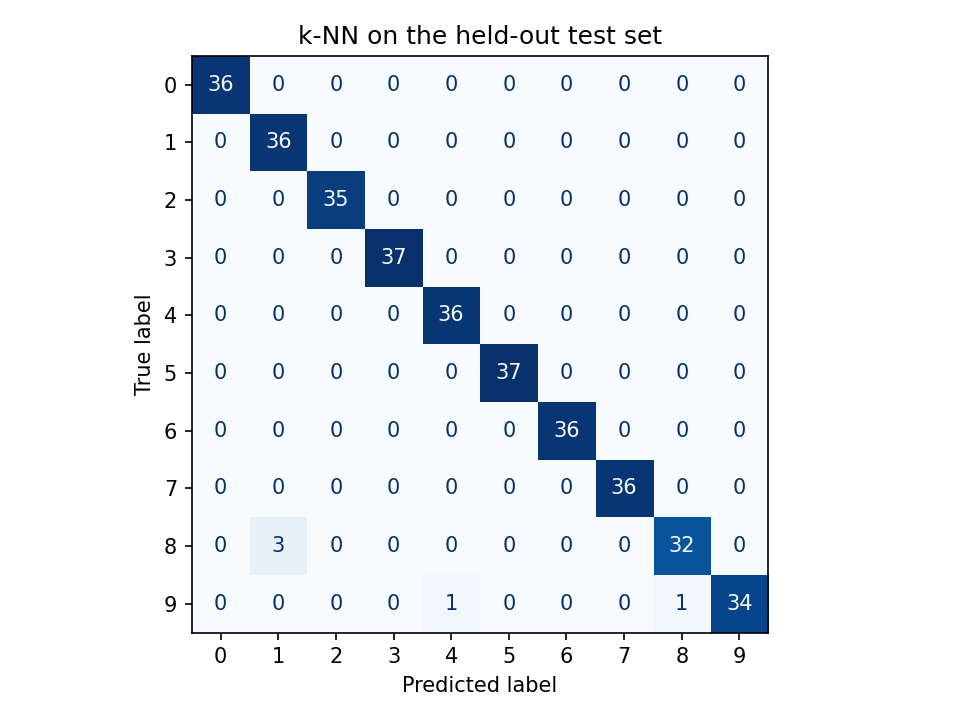

# K-Nearest Neighbors From Scratch

A NumPy implementation of image classification with Manhattan distance and uniform or inverse-distance voting. The project started as a 2022 chest X-ray image experiment. The default walkthrough now uses handwritten digits so the whole evaluation can run locally without downloading image files.



## Run the demo

Requires Python 3.10+. Run these commands in an activated virtual environment.

```bash
python -m pip install -r requirements.txt
python evaluate.py
python -m unittest discover -s tests
```

The [notebook](KNN_From_Scratch.ipynb) walks through nearest-neighbor search, selection and evaluation. To run it interactively, install JupyterLab in the same environment and launch it from the repository root. The demo uses the 1,797 8 × 8 samples shipped with [scikit-learn's digits dataset](https://scikit-learn.org/stable/modules/generated/sklearn.datasets.load_digits.html). Here the experiment uses its own stratified split.

| Split | Images | Role |
| --- | ---: | --- |
| Fit | 1,077 | Learn the reference examples |
| Validation | 360 | Select k and voting method by macro F1 |
| Test | 360 | Evaluate the model once after refitting on fit and validation |

The verified run selected **k = 1, uniform voting**. Test accuracy and macro F1 both rounded to **0.986**. The CLI saves the validation grid and per-class test metrics in `outputs/metrics.json`.

## Implementation

`knn.py` converts image features to floating point before subtracting them, so byte-valued pixels cannot wrap around. Neighbors are sorted by distance and stable training order. With inverse-distance voting, exact matches receive the entire vote. Equal class totals use a deterministic class order. Search is brute force, which makes the mechanics visible and limits practicality on large image datasets.

## Revisit the original image experiment

```bash
python evaluate.py --xray-dir chest_xray --output outputs/xray
```

Provide `train/<class>/` and `test/<class>/` folders with `covid`, `normal` and `pneumonia` class names. The optional runner compares 32 × 32 and 64 × 64 pixels and three preprocessing variants on validation data. Keep the supplied train and test sets disjoint by patient. Validation within the provided train directory is image-level. Use the digit results above as the reproducible example. The X-ray pathway is an educational exercise.

The [2022 notebook](https://github.com/aydinaliutku/KNN-From-Scratch/blob/12fd84740653adbed73cdbd6a17941f0bdb572d1/KNN_From_Scratch.ipynb) preserves the original analysis. Its table used the same test images to select k and measure performance, so the historical scores are unsuitable as holdout results.
